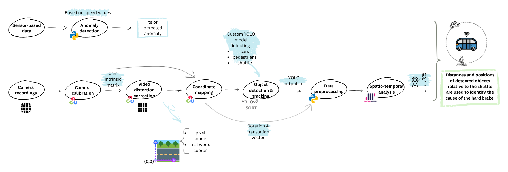
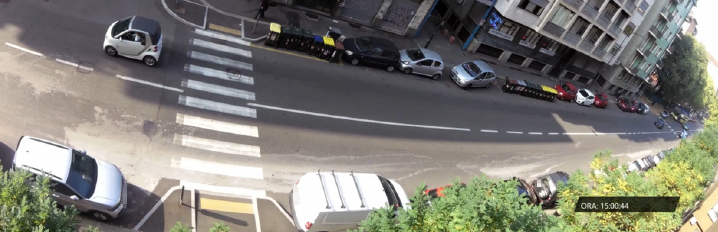
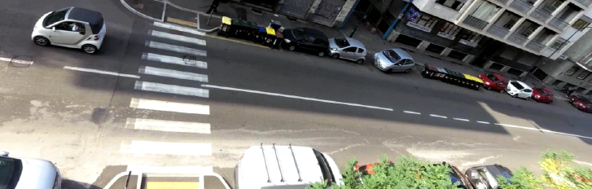
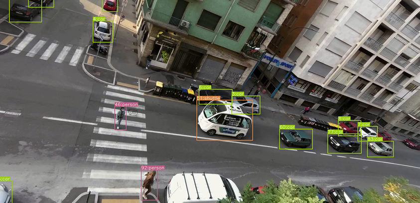
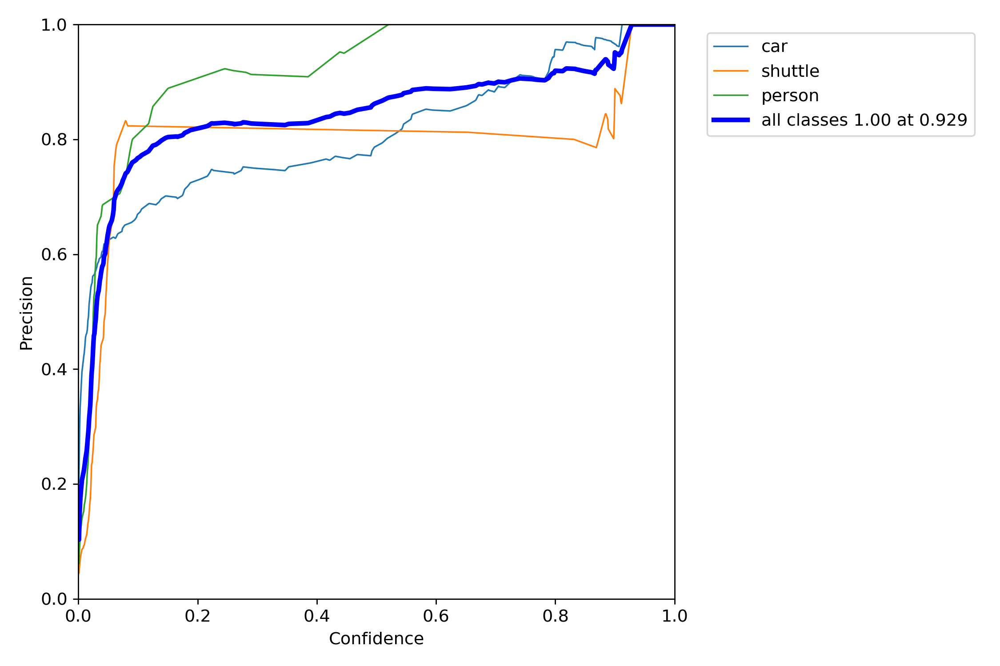
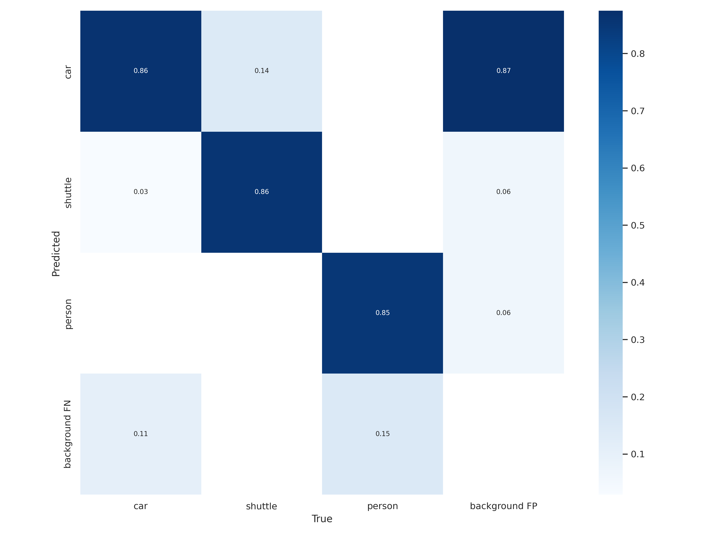
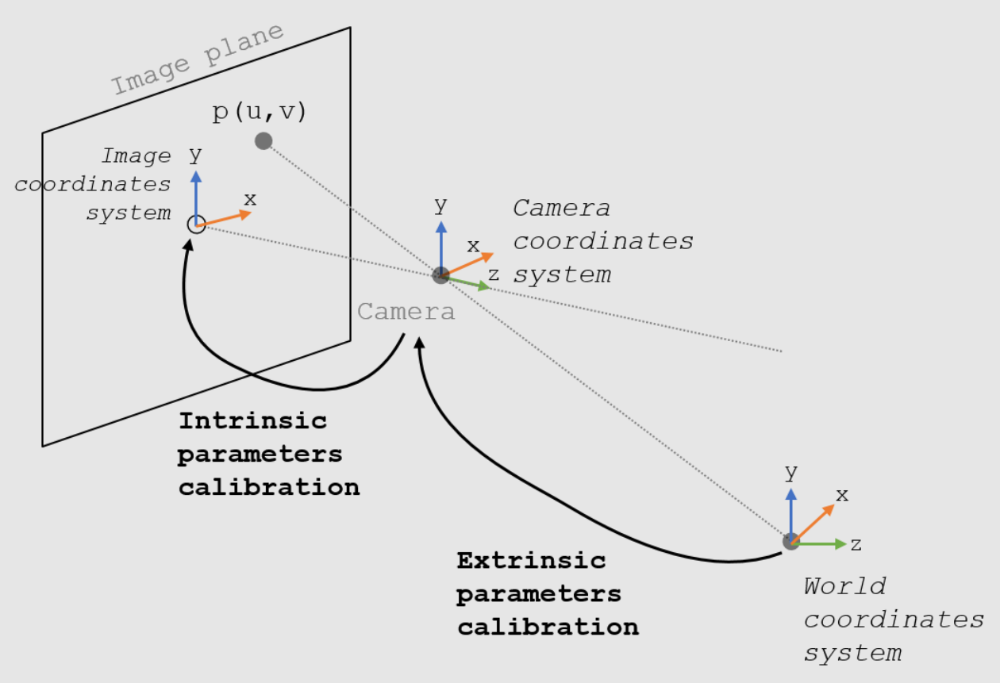
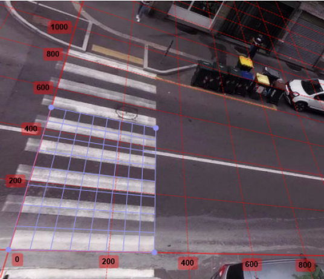
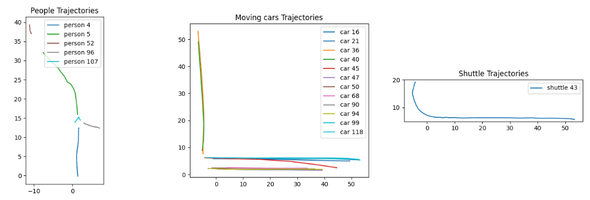

# Interaction Analysis of an Autonomous Shuttle with Other Road Users During Anomalous Braking Events

A computer-vision pipeline that turns roadside camera footage into **real-world trajectories** of cars, pedestrians and an autonomous shuttle, so you can explain _why_ the shuttle reacted the way it did, for example the cause of a sudden hard brake.

The pipeline corrects lens distortion, detects and tracks road users with **YOLOv7 + SORT**, projects their pixel positions onto the road plane in **metres**, and analyses the resulting trajectories with **MovingPandas**.

<p align="center">
  
</p>

---

## Table of contents

- [How it works](#how-it-works)
- [Repository structure](#repository-structure)
- [Installation](#installation)
- [Usage](#usage)
  - [1. Lens distortion correction](#1-lens-distortion-correction)
  - [2. Object detection and tracking](#2-object-detection-and-tracking)
  - [3. Pixel to real-world coordinate mapping](#3-pixel-to-real-world-coordinate-mapping)
  - [4. Spatio-temporal trajectory analysis](#4-spatio-temporal-trajectory-analysis)
- [Adapting it to your own scene](#adapting-it-to-your-own-scene)
- [Acknowledgements](#acknowledgements)
- [License](#license)

---

## How it works

| Step                                    | What happens                                                                                                                       | Output                                           |
| --------------------------------------- | ---------------------------------------------------------------------------------------------------------------------------------- | ------------------------------------------------ |
| **0. Event detection** _(not included)_ | Anomalies such as hard brakes are found in the vehicle's speed data.                                                               | Timestamp of the event                           |
| **1. Undistortion**                     | Camera intrinsics and distortion coefficients remove the wide-angle lens distortion.                                               | Rectified video                                  |
| **2. Detection and tracking**           | A custom YOLOv7 model detects `car`, `person` and `shuttle`; SORT gives each object a persistent ID.                               | One label file per frame                         |
| **3. Coordinate mapping**               | `solvePnP` on known ground points gives the camera pose; each detection is back-projected onto the road plane.                     | CSV with `x_3d`, `y_3d` in metres and timestamps |
| **4. Trajectory analysis**              | Trajectories are built and filtered (parked vs. moving cars) and the road users around the shuttle at the event time are reported. | Plots and relative positions/distances           |

---

## Repository structure

```
.
├── 01_undistortion/
│   └── undistort.py                 # remove lens distortion from a video
├── 02_detection_tracking/
│   ├── detect_and_track.py          # YOLOv7 inference + SORT tracking
│   ├── sort.py                      # SORT tracker (Kalman filter + Hungarian matching)
│   └── requirements.txt
├── 03_coordinate_mapping/
│   └── process_yolo_output.py       # pixel -> real-world coordinates (metres)
├── 04_trajectory_analysis/
│   └── trajectory_analysis.ipynb    # trajectory building and event analysis
├── config/
│   └── camera.yaml                  # camera intrinsics, distortion, ground control points
├── assets/                          # images used in this README
├── requirements.txt
```

---

## Installation

```bash
git clone https://github.com/<your-username>/<your-repo>.git
cd <your-repo>
python -m venv .venv
source .venv/bin/activate          # Windows: .venv\Scripts\activate
pip install -r requirements.txt
```

Step 2 runs inside the official [YOLOv7](https://github.com/WongKinYiu/yolov7) repository (see below).

---

## Usage

### 1. Lens distortion correction

Wide-angle surveillance cameras bend straight lines. Using the intrinsic matrix and distortion coefficients in [`config/camera.yaml`](config/camera.yaml), every frame is rectified and cropped to the valid region.

```bash
cd 01_undistortion
python undistort.py --input input_video.mp4 --output undistorted.mp4 --config ../config/camera.yaml
```

|                                  Before                                   |                                    After                                    |
| :-----------------------------------------------------------------------: | :-------------------------------------------------------------------------: |
|  |  |

### 2. Object detection and tracking

A YOLOv7 model fine-tuned on three classes (`car`, `person`, `shuttle`) detects road users in each frame. The SORT tracker links detections over time and gives each object a unique ID.

```bash
git clone https://github.com/WongKinYiu/yolov7.git
cp 02_detection_tracking/detect_and_track.py 02_detection_tracking/sort.py yolov7/
cd yolov7
pip install -r ../02_detection_tracking/requirements.txt

python detect_and_track.py --weights best.pt --source ../01_undistortion/undistorted.mp4 \
    --img-size 640 --conf-thres 0.6 --track --save-txt
```

`best.pt` is your trained model weight file (not included). With `--track --save-txt`, one label file per frame is written to `runs/detect/exp*/labels/`, one line per object:

```
classname  obj_id  class_id  x_center  y_center  width  height     # box values normalised to [0, 1]
```

Useful flags: `--show-track` draws trajectories, `--view-img` displays live results, `--unique-track-color` gives each track its own colour.

<p align="center">
  
</p>

**Model performance on the validation set:**

|                        Precision–confidence curve                         |                              Confusion matrix                               |
| :-----------------------------------------------------------------------: | :-------------------------------------------------------------------------: |
|  |  |

### 3. Pixel to real-world coordinate mapping

To measure distances in metres, pixel coordinates are mapped onto the road plane:

1. **Intrinsics** (focal length, principal point) relate the camera to the image plane.
2. **Extrinsics** (rotation and translation) relate the world to the camera. They are estimated with `cv2.solvePnP` from a few ground points whose positions are known in both the image and the real world, such as crosswalk stripe corners.
3. Each detection's pixel `(u, v)` is back-projected as a ray and intersected with the ground plane `Z = 0`.

|                                        Camera model                                        |                           World reference grid on the road (cm)                            |
| :----------------------------------------------------------------------------------------: | :----------------------------------------------------------------------------------------: |
|  |  |

Arrange the outputs of step 2 like this (one sub-folder per video):

```
sample_input/
└── scene_1/
    ├── undistorted.mp4     # used only to read the frame size
    ├── ts.txt              # video start time: "YYYY-MM-DD HH:MM:SS"
    └── labels/             # label files from step 2
```

```bash
cd 03_coordinate_mapping
python process_yolo_output.py --input-dir ./sample_input --fps 30 \
    --config ../config/camera.yaml --output coords_3d.csv
```

The resulting CSV has one row per object per frame, including `scene`, `ts`, `x_px_coord`, `y_px_coord`, `x_3d` and `y_3d` (metres).

### 4. Spatio-temporal trajectory analysis

Open [`04_trajectory_analysis/trajectory_analysis.ipynb`](04_trajectory_analysis/trajectory_analysis.ipynb) and set the parameters in the first cell: CSV path, event timestamp, time window and distance thresholds. The notebook:

- builds a [MovingPandas](https://github.com/movingpandas/movingpandas) `TrajectoryCollection` per object,
- splits cars into **parked** and **moving** by trajectory length,
- plots the trajectories of people, moving cars and the shuttle,
- lists the moving cars within a distance threshold of the shuttle around the event and says whether each is **in front of**, **behind** or **next to** the shuttle,
- plots speed along the trajectories.

<p align="center">
  
</p>

Example result (one row per nearby road user per second):

| ts                  | object      | position    | distance_m |
| ------------------- | ----------- | ----------- | ---------- |
| 2022-10-27 17:10:50 | ('car', 45) | in front of | 7.73       |

---

## Adapting it to your own scene

1. **Calibrate your camera**, for example with a checkerboard and `cv2.calibrateCamera`, and put `fx, fy, cx, cy` and the distortion coefficients in `config/camera.yaml`.
2. **Measure ground control points**: pick at least 4 (ideally 8 or more) well-spread points on the road whose real-world positions you know, such as lane markings or crosswalk corners. Add their pixel coordinates in the undistorted frame (`image_points`) and their world coordinates in millimetres (`world_points`, `Z = 0`).
3. **Train or choose a detector**: replace `best.pt` with your own YOLOv7 weights, or use the COCO-pretrained `yolov7.pt`.
4. **Tune the analysis**: adjust the thresholds and the `EGO_CLASS` name in the notebook's parameter cell.

> **Note:** The mapping uses the centre of each bounding box and assumes all points lie on a flat ground plane. For more accurate positions, use the bottom-centre of the box (the point touching the road).

---

## Acknowledgements

- [YOLOv7](https://github.com/WongKinYiu/yolov7): Wang, Bochkovskiy and Liao, _YOLOv7: Trainable bag-of-freebies sets new state-of-the-art for real-time object detectors_.
- [SORT](https://github.com/abewley/sort): Bewley et al., _Simple Online and Realtime Tracking_, ICIP 2016.
- [MovingPandas](https://github.com/movingpandas/movingpandas): Graser, _MovingPandas: Efficient Structures for Movement Data in Python_.
- [OpenCV](https://opencv.org/) for camera calibration and pose estimation.


